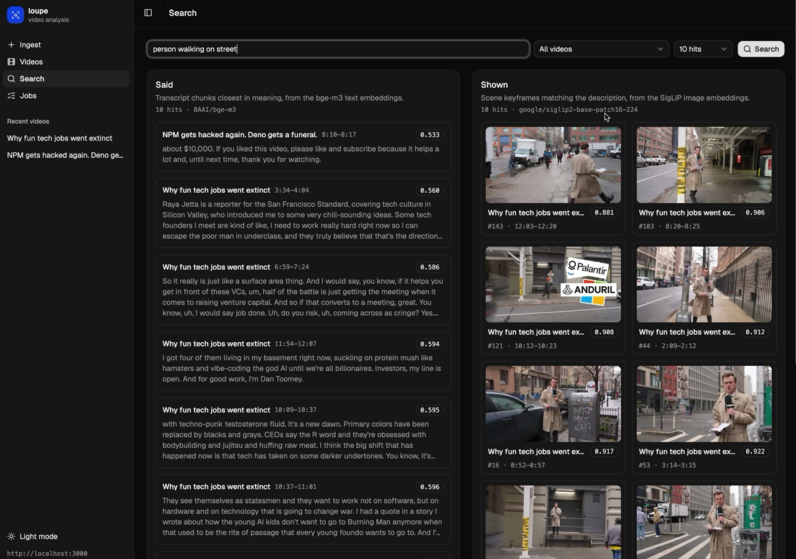
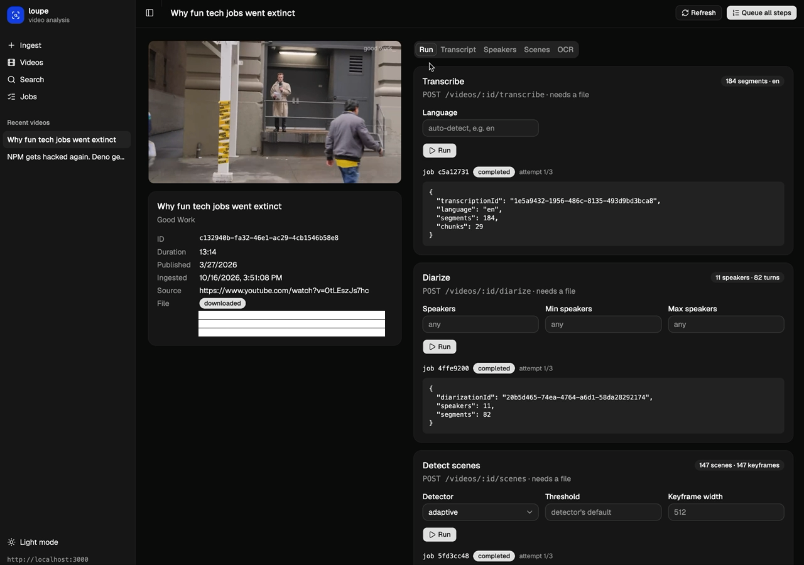
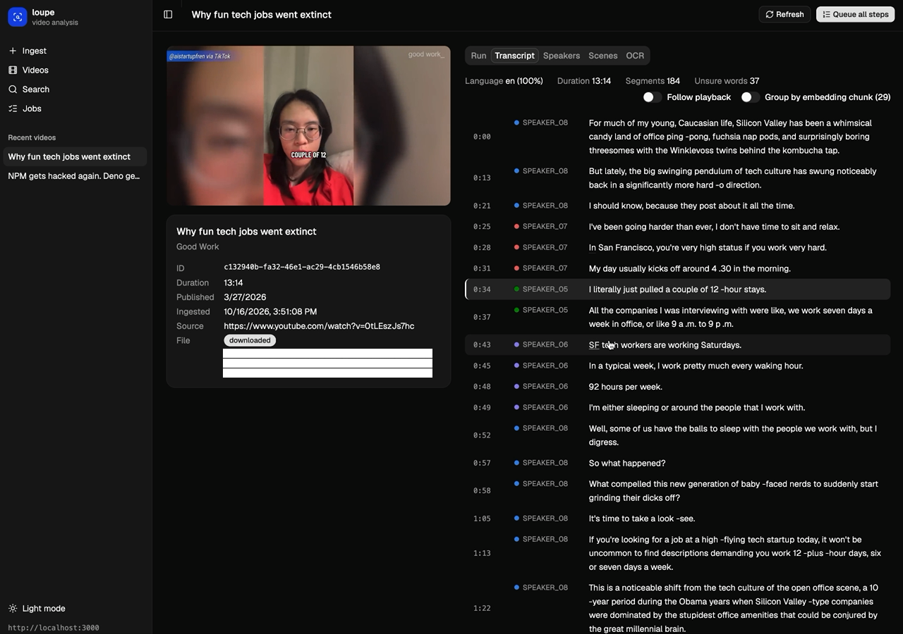
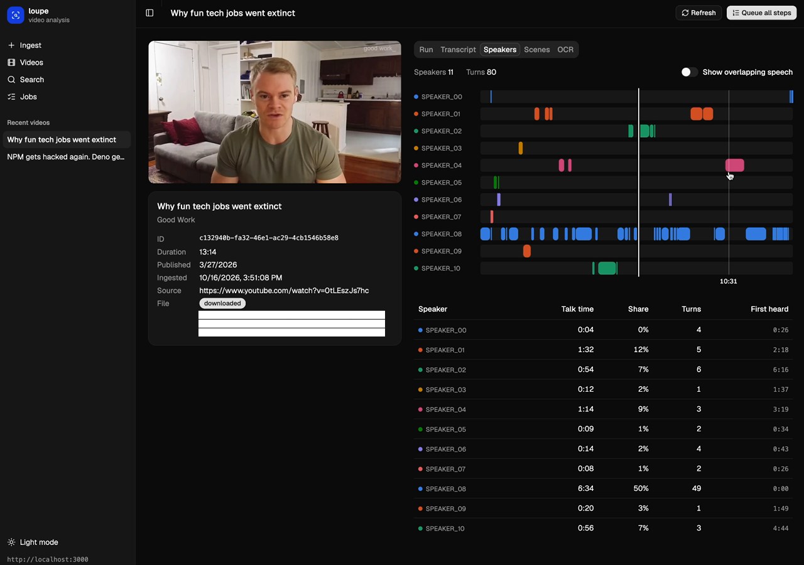
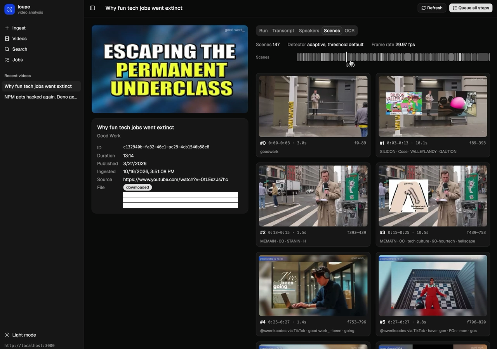
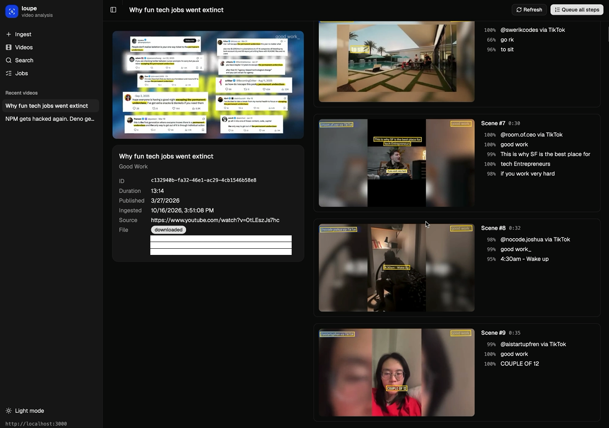

# Loupe

Loupe is a proof of concept for analysing videos with open-source ML models that run on your own machine. Give it a YouTube link and it downloads the video, transcribes it, works out who speaks when, splits it into scenes, reads the text on screen, and builds embeddings so you can search across your videos by what is said and by what is shown. Every result has timestamps, so you can jump straight to the moment in the video.



## What it uses

| Model / tool | Used for |
| --- | --- |
| [faster-whisper](https://github.com/SYSTRAN/faster-whisper) `large-v3-turbo` | Transcription with word timings and language detection |
| [pyannote `speaker-diarization-community-1`](https://huggingface.co/pyannote/speaker-diarization-community-1) | Speaker diarization (who speaks when) |
| [PySceneDetect](https://www.scenedetect.com/) | Scene detection, with one keyframe per scene |
| [RapidOCR](https://github.com/RapidAI/RapidOCR) | Text on screen, read from the keyframes |
| [SigLIP 2](https://huggingface.co/google/siglip2-base-patch16-224) `siglip2-base-patch16-224` | Keyframe embeddings, and embeddings of text queries for searching images |
| [bge-m3](https://huggingface.co/BAAI/bge-m3) | Transcript embeddings for searching by meaning |
| [yt-dlp](https://github.com/yt-dlp/yt-dlp) | Video metadata and downloads |

Each model has its own license. Check the linked pages before using Loupe for anything beyond experiments.

## How it fits together

The repo has three apps:

- **`workers/`**: a FastAPI app that wraps the ML models. It loads them once and turns a file into JSON. It knows nothing about jobs or storage.
- **`backend/`**: a NestJS API that does everything else. It runs yt-dlp, queues the analysis steps and runs them one at a time against the worker, stores the results in SQLite with [sqlite-vec](https://github.com/asg017/sqlite-vec) for the vectors, and serves the results and search endpoints.
- **`frontend/`**: a Vite + React client for ingesting videos, running steps, browsing results and searching.

[`CLAUDE.md`](CLAUDE.md) documents the architecture, the database, the job queue and every endpoint in detail.

## Requirements

- **Node.js 24** (tested with this version)
- **[uv](https://docs.astral.sh/uv/)**, which also installs the Python version the worker needs (3.13+)
- **[yt-dlp](https://github.com/yt-dlp/yt-dlp#installation)** on your `PATH`
- **[FFmpeg](https://ffmpeg.org/download.html)**: yt-dlp needs it to merge downloads, and pyannote needs its libraries to decode audio
- **A free [Hugging Face](https://huggingface.co) account**, to download the pyannote model
- **Hardware:** the models take about 7–9 GB of RAM once loaded. An NVIDIA GPU is strongly recommended. On a Mac, diarization and the embedding models use the Apple GPU, but faster-whisper has no Apple GPU support and runs on the CPU, so transcription is slow. Scene detection and OCR run on the CPU everywhere.

## Setup

1. **Hugging Face access.** Create an access token under *Settings → Access Tokens*. Then open the [pyannote model page](https://huggingface.co/pyannote/speaker-diarization-community-1) and accept its conditions. The model is gated, so the token alone isn't enough.

2. **Worker settings.**

   ```bash
   cp workers/.env.default workers/.env
   ```

   Set `HF_TOKEN` to your token. Leave `HF_HUB_OFFLINE` empty for now. Once the models are downloaded you can set it to `1` to stop the worker from contacting Hugging Face at startup.

3. **Install everything and download the models** (about 5.5 GB):

   ```bash
   make install
   ```

The backend and frontend work without any configuration. `frontend/.env.example` and the table in [`CLAUDE.md`](CLAUDE.md#backend-environment) list the optional settings (ports, the worker URL, the storage paths).

## Running it

Start each app in its own terminal:

```bash
make dev-workers    # ML worker on http://localhost:8000; loading the models takes a moment
make dev-backend    # API on http://localhost:3000
make dev-frontend   # UI on http://localhost:5173
```

Then open http://localhost:5173, paste a YouTube link on the Ingest page, and wait for the download to finish. On the video's page, click **Queue all steps** to run transcription, diarization, scene detection, OCR and both kinds of embeddings. When the steps are done, try the Search page.

Everything is stored in `backend/data/`: the SQLite database, the downloaded videos and the keyframes. Delete that folder to start over.

## Limitations

- **A proof of concept.** It's built to find out how far local models get, not to run in production.
- **YouTube links only**, through yt-dlp.
- **One job at a time.** The backend runs the steps in sequence against a single worker, so the GPU sits idle during downloads and scene detection.
- **No authentication.** The API accepts requests from any origin. Run it on your own machine and don't expose it to the internet.

Downloading videos may conflict with YouTube's terms of service. You are responsible for what you download and how you use it.

## License

Loupe's code is released under the [MIT License](LICENSE). The models it downloads have their own licenses; see the links in [What it uses](#what-it-uses).

## Screenshots

The screenshots show Loupe's analysis of two public YouTube videos: [Why fun tech jobs went extinct](https://www.youtube.com/watch?v=0tLEszJs7hc) by Good Work, and [NPM gets hacked again. Deno gets a funeral.](https://www.youtube.com/watch?v=UEF76vVMnVw) by Awesome. All rights to the videos belong to their creators.

### Video



### Transcript



### Speakers



### Scenes



### OCR


